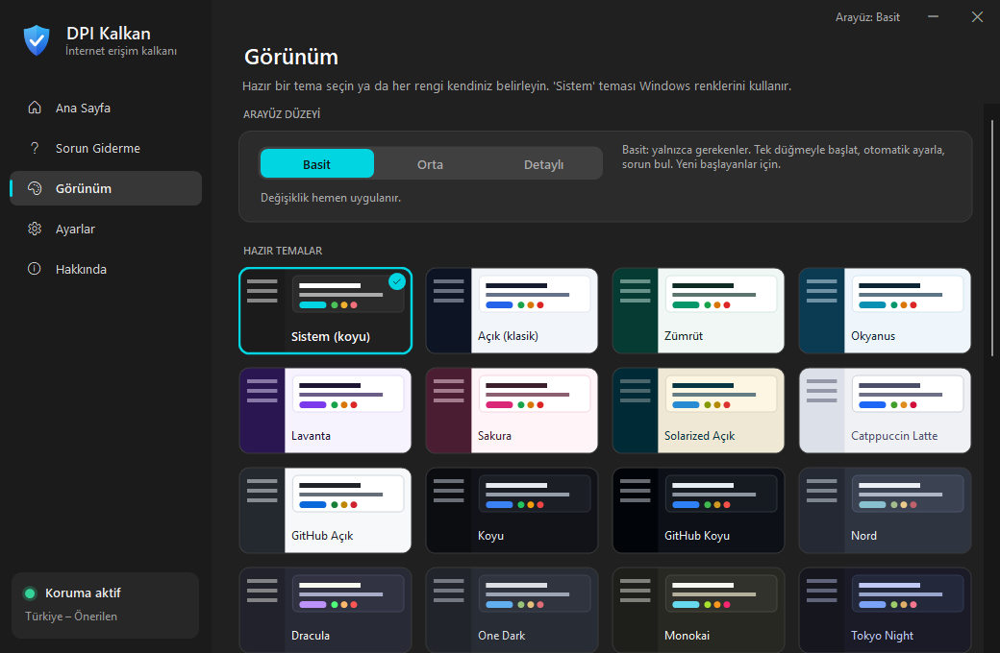
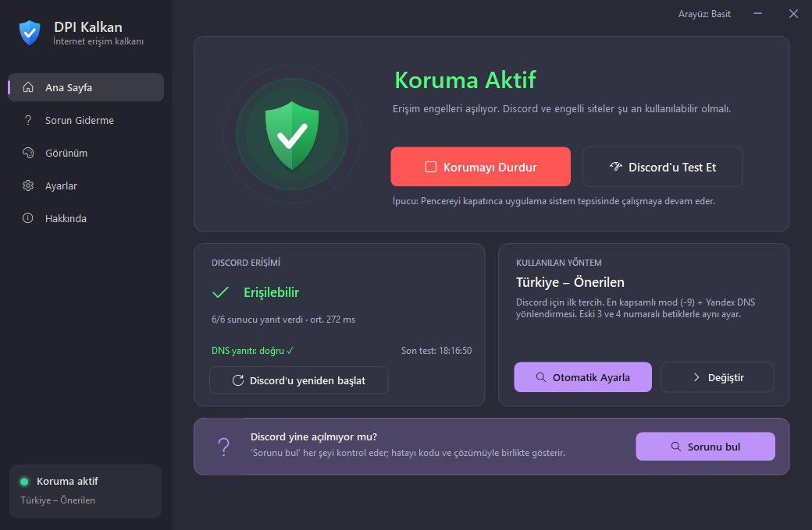

# DPI Kalkan

**GoodbyeDPI için kolay kullanımlı, Türkçe internet erişim kalkanı.** Servis sağlayıcıların DNS ve DPI (Derin Paket İnceleme) ile uyguladığı erişim engellerini (ör. Discord) tek tıkla aşar; çalışan yöntemi kendisi bulur, bozulunca kendisi onarır.

> VPN değildir: trafiğiniz şifrelenmez, IP adresiniz değişmez. Yalnızca Windows 10/11.


## İndir

**[Son sürümü indir (Releases)](https://github.com/Mr-Leywin/dpi-kalkan/releases/latest)**

1. `DPI-Kalkan-x.y.z.zip` dosyasını indirin, sağ tıklayıp **Tümünü ayıkla** deyin, klasörü kalıcı bir yere koyun.
2. `DPIKalkan.exe`'yi çalıştırın ve yönetici iznini onaylayın (ağ sürücüsü için gerekli).
3. Windows "Bilgisayarınız korundu" derse **Ek bilgi → Yine de çalıştır** deyin. Uygulama henüz dijital olarak imzalı değildir.

Ek kurulum gerekmez: .NET Framework 4.8, Windows 10/11'de zaten yüklüdür. Ayrıntılı Türkçe kullanım rehberi pakette `Rehber.html` olarak bulunur.

## Özellikler

- **Tek tıkla koruma:** Sistem tepsisinde çalışır, görev çubuğunda görünmez. Windows ile başlayabilir ya da arka plan hizmeti olarak çalışabilir.
- **En iyi yöntemi bul:** Engelin türünü (DNS mi, DPI mı) belirler. Her yöntemi DNS doğrulamasıyla iki tur test eder ve gerçekten çalışanı seçer. Başarısız bir DPI yönteminin farklı DNS'li kopyalarını atlar.
- **Otomatik onarım ve bağlantı bekçisi:** Discord'a erişim kesilirse (servis sağlayıcı yöntem değiştirdiğinde, Wi-Fi değiştiğinde) çalışan yöntemi kendisi bulur.
- **22 hazır yöntem, 7 DNS sunucusu:** Yandex, AdGuard, Quad9, OpenDNS, Cloudflare ve Google. Her seçeneğin ne işe yaradığı sade Türkçe ile anlatılır; kendi profillerinizi oluşturup kodla paylaşabilirsiniz.
- **Sorun Giderme:** 20'den fazla noktayı kontrol eden tam tarama, 10 kategoride 44 hata kodu (DK-xxx), her biri için çözüm adımları ve tek tıkla düzeltme.
- **İnternet Kontrolü:**
  - Site analizi (DNS / TCP / TLS / HTTP adım adım)
  - DNS sunucu testi
  - Hız testi
  - Grafikli bağlantı geçmişi
  - Ağ bilgisi
- **DNS Ayarları:** Windows DNS'ini değiştirme ve Windows 11'de şifreli DNS (DoH).
- **Proxy:**
  - HTTP/SOCKS5, kullanıcı adı/şifreli proxy desteği
  - Toplu test
  - Windows proxy'si
  - **Program bazlı proxy:** Proxy yalnızca seçtiğiniz programlarda (Chrome, Edge, Opera, Firefox, Discord, Spotify…) kullanılır.
  - Yerel köprü sayesinde şifreli proxy'leri desteklemeyen programlar da şifreli proxy kullanabilir.
- **Görünüm:** Windows renklerini izleyen "Sistem" teması ve 20 hazır tema. Her renk renk koduyla değiştirilebilir. Basit / Orta / Detaylı arayüz.
- **Yedek betikler:** Uygulama olmadan çalışan `.cmd` dosyaları. Ayarları dışa ve içe aktarma.

| | |
|---|---|
|  |  |
|  |  |
|  |  |

## Nasıl çalışır?

Türkiye'de Discord iki katmanda engelleniyor:
1. **DNS:** Servis sağlayıcının DNS'i sahte adres döndürür.
2. **DPI:** Bağlantıdaki site adı (SNI) okunup bağlantı kesilir.

DPI Kalkan, [GoodbyeDPI](https://github.com/ValdikSS/GoodbyeDPI)'ı doğru parametrelerle çalıştırır:
- **DNS yönlendirmesi**, sorguları standart dışı porttaki güvenli bir DNS sunucusuna gönderir.
- **Paket parçalama ve sahte paketler**, DPI cihazının site adını okumasını engeller.

Hangi yöntemin çalıştığı servis sağlayıcıya göre değişir; uygulama bunu sizin bağlantınızda test ederek bulur.

## Kaynaktan derleme

Gereksinimler: Windows 10/11 ve [.NET SDK](https://dot.net) (6 ya da üstü; yalnızca derleyicisi kullanılır, uygulama .NET Framework 4.8 hedefler).

```powershell
powershell -ExecutionPolicy Bypass -File build.ps1            # derle + paketle → dist\DPI-Kalkan-<sürüm>.zip
powershell -ExecutionPolicy Bypass -File build.ps1 -Preview   # ayrıca ekran görüntüleri → build\screens
powershell -ExecutionPolicy Bypass -File build.ps1 -Check     # yalnızca derleme kontrolü
```

Klasör yapısı:

| Klasör | İçerik |
|---|---|
| `src/Core` | Motor (GoodbyeDPI yönetimi), tarayıcı, ağ testleri, hata kataloğu, proxy ve köprü, DNS ayarları |
| `src/UI` | WinForms arayüzü: tema sistemi ve sayfalar |
| `docs/Rehber.html` | Kullanım rehberi şablonu (hata kodları ve yöntemler derlemede eklenir) |
| `third_party/goodbyedpi` | GoodbyeDPI 0.2.3rc3 resmi dosyaları (değiştirilmemiş, SHA-256 listeli) |

## Lisans

- **DPI Kalkan kaynak kodu:** [MIT](LICENSE).
- **Birlikte dağıtılan bileşenler** kendi lisanslarına tabidir:
  - GoodbyeDPI: Apache 2.0, © ValdikSS
  - WinDivert: LGPL v3, © basil00
  - Ayrıntılar: [THIRD_PARTY_NOTICES.md](THIRD_PARTY_NOTICES.md)
- DPI Kalkan; GoodbyeDPI, WinDivert ya da Discord geliştiricileriyle bağlantılı değildir.

## Sorumluluk reddi

Bu yazılım "olduğu gibi" sunulur. Kullanımından doğan sorumluluk kullanıcıya aittir; lütfen bulunduğunuz yerin yasalarına uygun kullanın. Bazı antivirüs programları WinDivert sürücüsünü "RiskTool" olarak işaretleyebilir. Bu bir virüs değildir; ağ paketlerini işleyen bir sürücü olduğu için bu şekilde etiketlenir.

---

### English

DPI Kalkan is a Turkish-language Windows GUI for [GoodbyeDPI](https://github.com/ValdikSS/GoodbyeDPI) that bypasses DNS- and DPI-based censorship (e.g. the Discord block in Turkey).

Main features:
- Finds the working method automatically and self-heals when access breaks.
- Includes diagnostics with error codes and a site analyzer.
- Changes Windows DNS (with DoH) and offers per-application proxy with a local auth bridge.
- Supports themes.

The app's own code is MIT-licensed; bundled GoodbyeDPI (Apache 2.0) and WinDivert (LGPLv3) are unmodified.
