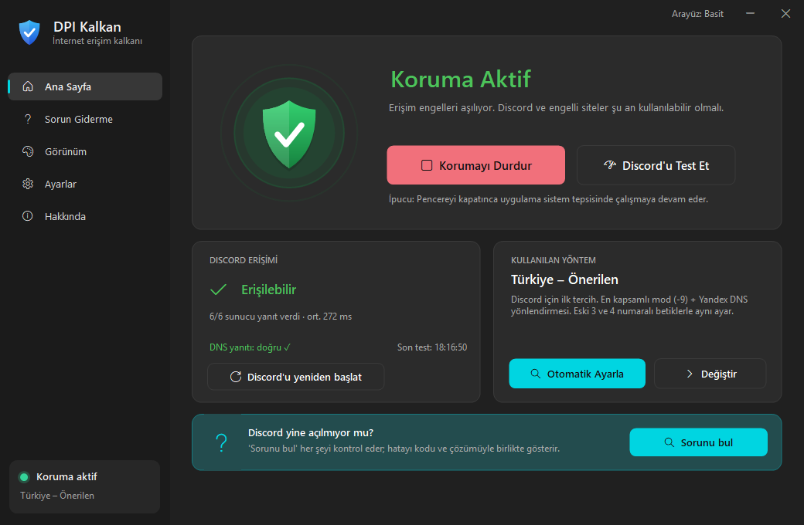
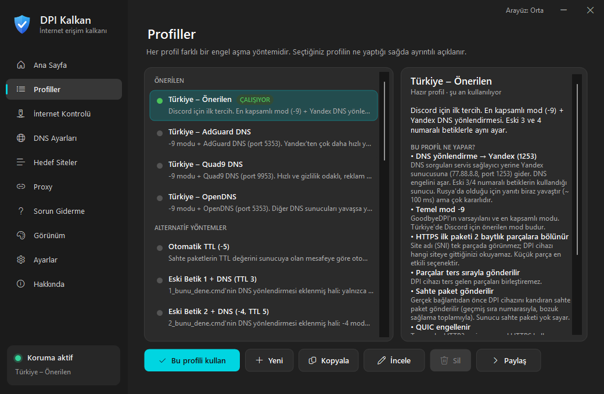
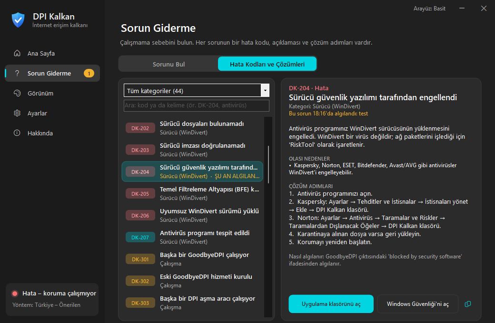
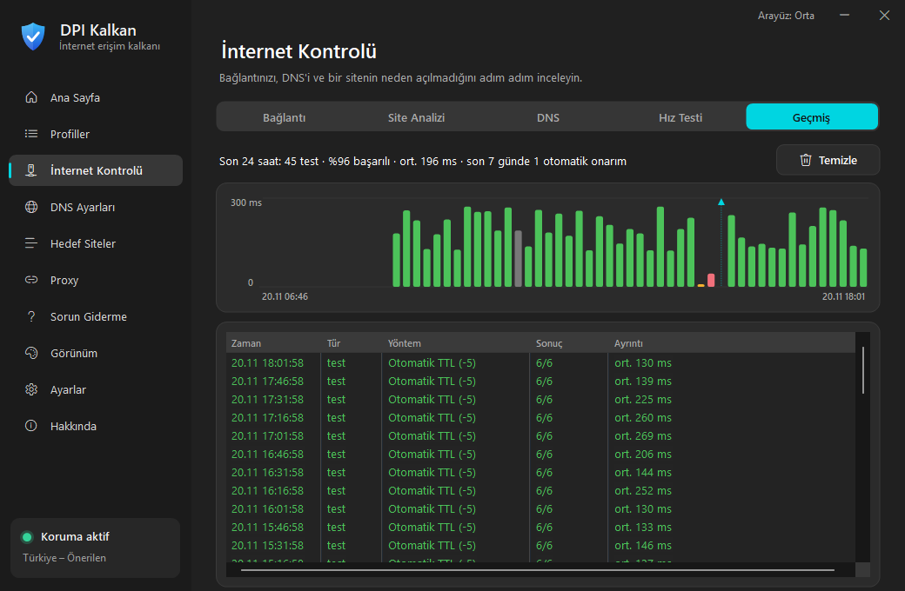
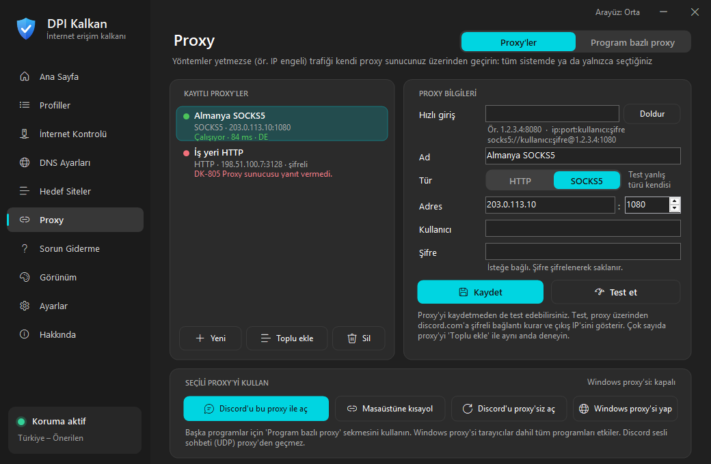

# DPI Kalkan

[](https://github.com/Mr-Leywin/dpi-kalkan/actions/workflows/build.yml) [](https://github.com/Mr-Leywin/dpi-kalkan/releases/latest) [](LICENSE)

**GoodbyeDPI için kolay kullanımlı, Türkçe internet erişim kalkanı.** Servis sağlayıcıların DNS ve DPI (Derin Paket İnceleme) ile uyguladığı erişim engellerini (ör. Discord) tek tıkla aşar; çalışan yöntemi kendisi bulur, bozulunca kendisi onarır.

> VPN değildir: trafiğiniz şifrelenmez, IP adresiniz değişmez. Yalnızca Windows 10/11.



## İndir ve kur

**[Son sürümü indir (Releases)](https://github.com/Mr-Leywin/dpi-kalkan/releases/latest)**

İki biçimde dağıtılır:

| | **Kurulumlu** – `DPI-Kalkan-x.y.z-Setup.exe` (önerilen) | **Taşınabilir** – `DPI-Kalkan-x.y.z.zip` |
|---|---|---|
| Kurulduğu yer | `C:\Program Files\DPI Kalkan` | Seçtiğiniz herhangi bir klasör |
| Koruma (uygulama modu) | ✔ | ✔ |
| Arka plan hizmeti (uygulama kapalıyken de çalışır) | ✔ | – (güvenlik gereği kapalı) |
| Windows açılışında otomatik başlatma | ✔ | – (güvenlik gereği kapalı) |
| Güncelleme | Kurulum paketiyle, sessizce | Zip ile, yerinde |
| Kaldırma | Ayarlar → Uygulamalar | Ayarlar → Temiz kaldır, sonra klasörü silin |
| Windows | 64 bit | 32 ve 64 bit |

**Kurulumlu sürüm:** `Setup.exe`'yi çalıştırın ve yönetici iznini onaylayın. Program Files'a kurulur, Başlat menüsüne eklenir ve Program Ekle/Kaldır listesinde görünür.

**Taşınabilir sürüm:** Zip'e sağ tıklayıp **Tümünü ayıkla** deyin, `DPIKalkan.exe`'yi çalıştırıp yönetici iznini onaylayın. Zip'in içinden çalıştırmayın.

Windows "Bilgisayarınız korundu" derse **Ek bilgi → Yine de çalıştır** deyin (nedeni aşağıda: [Antivirüs, SmartScreen ve doğrulama](#antivirüs-smartscreen-ve-doğrulama)). Ek bir şey kurmanız gerekmez: .NET Framework 4.8 Windows 10/11'de zaten yüklüdür. Ayrıntılı Türkçe kullanım rehberi pakette `Rehber.html` olarak bulunur.

### Hizmet ve otomatik başlatma neden yalnızca kurulumlu sürümde?

Arka plan hizmeti GoodbyeDPI'ı **SYSTEM** yetkisiyle, "Windows açılışında başlat" ise DPI Kalkan'ı **izin sormadan yönetici olarak** çalıştırır. Masaüstü ya da İndirilenler gibi herkesin yazabildiği bir klasördeki dosyalar bu yetkilerle çalıştırılırsa, bilgisayardaki zararlı bir program o dosyaları değiştirip yetki kazanabilir. Bu yüzden DPI Kalkan bu iki özelliği yalnızca **yöneticilerin yazabildiği bir klasöre** (Program Files) kurulduğunda açar. Taşınabilir sürüm uygulama modunda normal çalışır; uygulama açık (tepside) kaldığı sürece koruma sürer. Daha önce taşınabilir bir klasörden kurulmuş bir hizmet ya da açılış görevi varsa, uygulama açılışta bunu güvenlik için kaldırır ve bildirir (DK-705).

### Güncelleme

Uygulama günde bir kez yeni sürümü denetler ve ana sayfada bildirir. Kurulum her zaman sizin onayınızla yapılır:
- **Kurulumlu sürüm** `Setup.exe`'yi indirir, SHA-256 özetini ve sürüm bilgisini doğrular, sessiz yükseltme yapar ve kendini yeniden açar. Ayarlarınız korunur, hizmet çalışıyorsa yeniden başlatılır.
- **Taşınabilir sürüm** zip'i indirir, doğrular ve yerinde kurar. Önceki sürüm `veri\onceki-surum` klasörüne yedeklenir; hata olursa geri dönülür.

### Kaldırma

DPI Kalkan'ın Windows'ta yaptığı değişiklikleri (arka plan hizmeti, açılış görevi, WinDivert sürücü kaydı, Windows proxy'si, DNS sunucuları ve şifreli DNS kayıtları) geri alarak temizce kaldırılır:
- **Kurulumlu sürüm:** Ayarlar → Uygulamalar → DPI Kalkan → Kaldır. Ayarların (`veri` klasörü) da silinip silinmeyeceği sorulur.
- **Taşınabilir sürüm:** Uygulamada **Ayarlar → Temiz kaldır**, ardından klasörü silin.
- **Komut satırı:** `DPIKalkan.exe --uninstall` (sessiz: `--uninstall --quiet`).

## Antivirüs, SmartScreen ve doğrulama

**Neden uyarı çıkabilir?**
- **SmartScreen:** DPI Kalkan henüz bir kod imzalama sertifikasıyla imzalı değildir. Windows yeni ve imzasız programlarda "Bilgisayarınız korundu" uyarısı gösterir.
- **Antivirüs:** GoodbyeDPI ağ paketlerini **WinDivert** sürücüsüyle işler. Bu davranış nedeniyle bazı antivirüsler GoodbyeDPI'ı ya da WinDivert'i "HackTool" veya "RiskTool" sınıfında işaretleyebilir. Bu dosyalar [resmi GoodbyeDPI 0.2.3rc3 sürümünden](https://github.com/ValdikSS/GoodbyeDPI/releases) **değiştirilmeden** alınmıştır.

**Dosyaları doğrulama:**
1. **SHA-256:** Her sürümün `SHA256SUMS.txt` dosyası kurulum paketinin, zip'in ve içindeki kritik dosyaların özetlerini içerir. İndirdiğiniz dosyanın özetini PowerShell ile hesaplayıp listedeki satırla karşılaştırın:
   ```powershell
   Get-FileHash .\DPI-Kalkan-2.4.0-Setup.exe -Algorithm SHA256
   ```
2. **Derleme kaynağı kanıtı (build provenance):** Sürüm dosyaları GitHub Actions'ta bu depodaki koddan derlenir ve GitHub tarafından imzalanmış bir kanıtla yayımlanır. [GitHub CLI](https://cli.github.com) ile:
   ```powershell
   gh attestation verify .\DPI-Kalkan-2.4.0-Setup.exe -R Mr-Leywin/dpi-kalkan
   ```
   Kanıtlar depodaki [Attestations](https://github.com/Mr-Leywin/dpi-kalkan/attestations) sayfasında da görülebilir. Derleme tekrarlanabilirdir: aynı koddan iki derleme aynı SHA-256'yı verir.
3. **Uygulama içinde:** Sorun Giderme → **Tam kontrolü başlat** → "Dosya bütünlüğü" satırı, GoodbyeDPI ve WinDivert dosyalarını programa gömülü resmi SHA-256 özetleriyle karşılaştırır. Bu denetim koruma her başlatıldığında da yapılır (DK-105).

**Antivirüs dosyayı engellerse:**
1. Yukarıdaki yollardan biriyle dosyanın resmi olduğunu doğrulayın ve karantinadan geri yükleyin.
2. Dosyayı Microsoft'a **yanlış pozitif** olarak bildirin: [microsoft.com/wdsi/filesubmission](https://www.microsoft.com/en-us/wdsi/filesubmission) → **Home customer** → dosyayı seçin → "Incorrectly detected as malware". Uygulamadaki **Yanlış pozitif bildir** düğmesi (Sorun Giderme → DK-204) bu sayfayı açar. Diğer antivirüslerin de benzer bildirim sayfaları vardır.
3. **Yalnızca son çare olarak** ve yalnızca DPI Kalkan klasörünü (tüm diski ya da İndirilenler'i değil) antivirüs istisnalarına ekleyin.

## Özellikler

- **Tek tıkla koruma:** Sistem tepsisinde çalışır, görev çubuğunda görünmez. Kurulumlu sürümde Windows ile başlayabilir ya da arka plan hizmeti olarak çalışabilir.
- **En iyi yöntemi bul:** Engelin türünü (DNS mi, DPI mı) belirler. Her yöntemi DNS doğrulamasıyla iki tur test eder ve gerçekten çalışanı seçer. Başarısız bir DPI yönteminin farklı DNS'li kopyalarını atlar.
- **Otomatik onarım ve bağlantı bekçisi:** Discord'a erişim kesilirse (servis sağlayıcı yöntem değiştirdiğinde, Wi-Fi değiştiğinde) çalışan yöntemi kendisi bulur.
- **22 hazır yöntem, 7 DNS sunucusu:** Yandex, AdGuard, Quad9, OpenDNS, Cloudflare ve Google. Her seçeneğin ne işe yaradığı sade Türkçe ile anlatılır; kendi profillerinizi oluşturup kodla paylaşabilirsiniz. Paylaşılan profiller güvenli parametre listesinden geçmeden eklenmez.
- **Sorun Giderme:** 20'den fazla noktayı kontrol eden tam tarama (dosya bütünlüğü ve kurulum türü dahil), 10 kategoride 48 hata kodu (DK-xxx), her biri için çözüm adımları ve tek tıkla düzeltme. Uygulama beklenmedik şekilde kapanırsa sonraki açılışta bildirir (DK-106).
- **İnternet Kontrolü:**
  - Site analizi (DNS / TCP / TLS / HTTP adım adım)
  - DNS sunucu testi
  - Hız testi
  - Grafikli bağlantı geçmişi
  - Ağ bilgisi
- **DNS Ayarları:** Windows DNS'ini değiştirme ve Windows 11'de şifreli DNS (DoH). Şifreli DNS Windows'un kendi aracıyla (`netsh`) açılır, her sunucu için sonucu geri okunarak doğrulanır; "Eski ayarlara dön" DNS sunucularını ve şifreli DNS kayıtlarını DPI Kalkan'dan önceki hâline getirir. Windows 10'da şifreli DNS desteklenmez; bu durumda açıkça bildirilir.
- **Proxy:**
  - HTTP/SOCKS5, kullanıcı adı/şifreli proxy desteği
  - Toplu test
  - Windows proxy'si
  - **Program bazlı proxy:** Proxy yalnızca seçtiğiniz programlarda (Chrome, Edge, Opera, Firefox, Discord, Spotify…) kullanılır.
  - Yerel köprü sayesinde şifreli proxy'leri desteklemeyen programlar da şifreli proxy kullanabilir.
- **Görünüm:** Windows renklerini izleyen "Sistem" teması ve 20 hazır tema. Her renk renk koduyla değiştirilebilir. Basit / Orta / Detaylı arayüz.
- **Yedek betikler:** Uygulama olmadan çalışan `.cmd` dosyaları. Ayarları dışa ve içe aktarma.
- **Güncelleme, kaldırma ve destek:** Doğrulamalı otomatik güncelleme, sistem değişikliklerini geri alan temiz kaldırma, kişisel bilgileri gizlenmiş destek paketi ve tek tıkla sorun bildirme.

| | |
|---|---|
|  |  |
|  |  |
|  |  |

## Nasıl çalışır?

Türkiye'de Discord iki katmanda engelleniyor:
1. **DNS:** Servis sağlayıcının DNS'i sahte adres döndürür.
2. **DPI:** Bağlantıdaki site adı (SNI) okunup bağlantı kesilir.

DPI Kalkan, [GoodbyeDPI](https://github.com/ValdikSS/GoodbyeDPI)'ı doğru parametrelerle çalıştırır:
- **DNS yönlendirmesi**, sorguları standart dışı porttaki güvenli bir DNS sunucusuna gönderir.
- **Paket parçalama ve sahte paketler**, DPI cihazının site adını okumasını engeller.

Hangi yöntemin çalıştığı servis sağlayıcıya göre değişir; uygulama bunu sizin bağlantınızda test ederek bulur.

## Kaynaktan derleme

Gereksinimler:
- Windows 10/11
- [.NET SDK](https://dot.net) – `global.json`'daki sürüm (8.0.201) önerilir. Yalnızca derleyicisi kullanılır; uygulama .NET Framework 4.8 hedefler. Başka bir SDK sürümüyle de derlenir ama çıktı CI'dakinden farklı olabilir.
- Kurulum paketi için [Inno Setup](https://jrsoftware.org/isdl.php) 6.7 (yoksa yalnızca zip üretilir)

```powershell
powershell -ExecutionPolicy Bypass -File build.ps1                      # derle → dist\: zip, Setup.exe, SHA256SUMS
powershell -ExecutionPolicy Bypass -File build.ps1 -Preview             # ayrıca ekran görüntüleri → build\screens
powershell -ExecutionPolicy Bypass -File build.ps1 -Check               # yalnızca derleme kontrolü
powershell -ExecutionPolicy Bypass -File build.ps1 -VerifyReproducible  # iki kez derleyip özetleri karşılaştırır
build\DPIKalkan.preview.exe --selftest sonuc.txt                        # birim testleri (FAIL satırı olmamalı)
```

Derleme tekrarlanabilirdir: derleyici `-deterministic` çalışır, dosyalar sabit sırayla ve sabit zaman damgasıyla (son commit zamanı ya da `SOURCE_DATE_EPOCH`) paketlenir. Kod imzalama sertifikası alındığında `DPK_SIGN_ARGS` (ve gerekirse `DPK_SIGNTOOL`) ortam değişkeni tanımlanarak exe ve kurulum paketi imzalanır; tanımlı değilse imzalama yapılmaz.

Klasör yapısı:

| Klasör | İçerik |
|---|---|
| `src/Core` | Motor (GoodbyeDPI yönetimi), güvenlik denetimleri, tarayıcı, ağ testleri, hata kataloğu, proxy ve köprü, DNS ayarları, güncelleme, kaldırma |
| `src/UI` | WinForms arayüzü: tema sistemi ve sayfalar |
| `installer` | Inno Setup kurulum betiği (`DPIKalkan.iss`) |
| `docs/Rehber.html` | Kullanım rehberi şablonu (hata kodları ve yöntemler derlemede eklenir) |
| `third_party/goodbyedpi` | GoodbyeDPI 0.2.3rc3 resmi dosyaları (değiştirilmemiş, SHA-256 listeli) |

## Sürüm yayımlama (geliştiriciler için)

1. `src/Program.cs` içindeki `AssemblyVersion`, `AssemblyFileVersion` ve `AssemblyInformationalVersion` değerlerini artırın (üçü aynı sürüm olmalı; `build.ps1` denetler).
2. `CHANGELOG.md` dosyasına yeni sürümün bölümünü ekleyin.
3. Değişikliği gönderin ve etiketleyin: `git tag v2.4.1` ve `git push origin v2.4.1`.

GitHub Actions paketi iki kez derleyip çıktıların aynı olduğunu doğrular, testleri çalıştırır ve sürümü `Setup.exe`, zip, `SHA256SUMS.txt` ve derleme kaynağı kanıtıyla yayımlar. Tüm eylemler commit SHA'sıyla, araç sürümleri ise özetleriyle sabitlenmiştir. Kullanıcıların uygulaması yeni sürümü kendisi bulur.

## Sorun bildirme

Uygulamada **Sorun Giderme → Sorun bildir** düğmesi bilgileri doldurulmuş bir sorun formu açar. **Destek paketi**, kişisel bilgileri gizlenmiş günlükleri tek dosyada toplar. Güvenlik açıkları için [SECURITY.md](SECURITY.md) dosyasına bakın. Değişiklikler: [CHANGELOG.md](CHANGELOG.md).

## Lisans

- **DPI Kalkan kaynak kodu:** [MIT](LICENSE), Copyright (c) 2026 Osman Barış MEDİNE (Mr Leywin).
- **Birlikte dağıtılan bileşenler** kendi lisanslarına tabidir:
  - GoodbyeDPI: Apache 2.0, © ValdikSS
  - WinDivert: LGPL v3, © basil00
  - Ayrıntılar: [THIRD_PARTY_NOTICES.md](THIRD_PARTY_NOTICES.md)
- DPI Kalkan; GoodbyeDPI, WinDivert ya da Discord geliştiricileriyle bağlantılı değildir.

## Sorumluluk reddi

Bu yazılım "olduğu gibi" sunulur. Kullanımından doğan sorumluluk kullanıcıya aittir; lütfen bulunduğunuz yerin yasalarına uygun kullanın. Antivirüs uyarıları için [Antivirüs, SmartScreen ve doğrulama](#antivirüs-smartscreen-ve-doğrulama) bölümüne bakın.

---

### English

DPI Kalkan is a Turkish-language Windows GUI for [GoodbyeDPI](https://github.com/ValdikSS/GoodbyeDPI) that bypasses DNS- and DPI-based censorship (e.g. the Discord block in Turkey).

- **Installer (recommended)** installs to Program Files; the SYSTEM background service and "start with Windows" are only available there, because running files from a user-writable folder with those privileges would allow privilege escalation. The **portable zip** runs in app mode.
- Finds the working method automatically and self-heals when access breaks; diagnostics with error codes and a site analyzer.
- Changes Windows DNS with verified DoH on Windows 11 (fully reversible), per-application proxy with a local auth bridge, clean uninstall (`--uninstall`).
- **Verification:** every release ships `SHA256SUMS.txt` and a GitHub build provenance attestation (`gh attestation verify <file> -R Mr-Leywin/dpi-kalkan`); builds are reproducible. Bundled GoodbyeDPI/WinDivert files are verified against embedded official SHA-256 hashes before every start. Some antivirus products flag GoodbyeDPI/WinDivert as a hacktool/risktool; please report false positives instead of adding broad exclusions.

The app's own code is MIT-licensed; bundled GoodbyeDPI (Apache 2.0) and WinDivert (LGPLv3) are unmodified.
